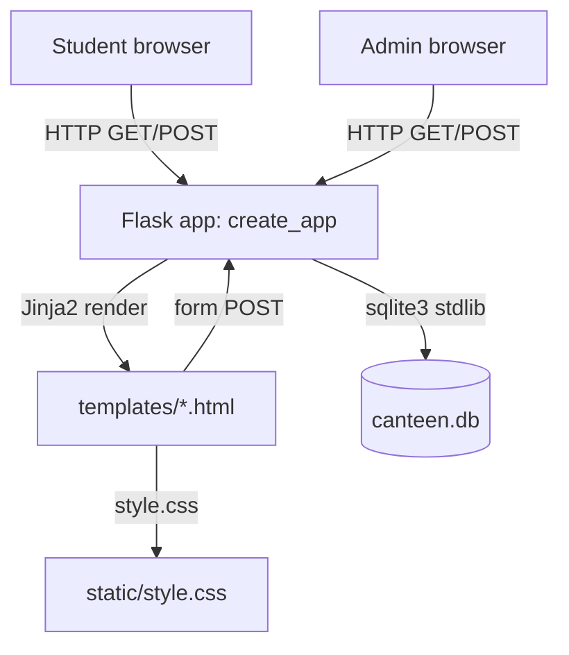
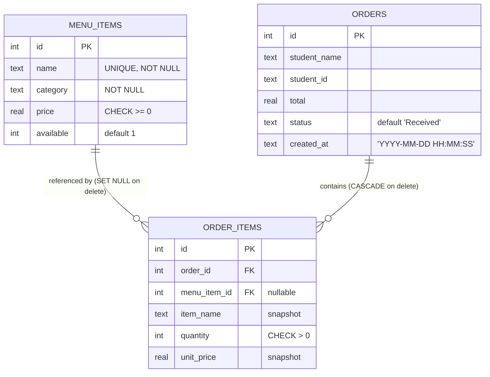

# College Canteen Management System — Technical Documentation

> Audience: future maintainers, evaluators, and anyone extending this project.
> Scope: architecture, data model, request flows, efficiency analysis, and extension guide.
> Status: working demo restructured into the final modular layout (Phase 0).
> Roadmap for the full system: see **[`BUILD_PLAN.md`](./BUILD_PLAN.md)**; requirements: **[`PRD.md`](./PRD.md)**.

---

## 1. What This Application Is

A small **server-rendered web app** that digitises a college canteen:

- **Students** browse the menu, pick quantities, submit an order, and get an order number.
- **Students** can later track an order by its number.
- **Canteen staff** (admin) manage the menu, update order status, and see today's totals.

It is deliberately minimal: a small Flask **package** (application factory + blueprints), **five Jinja templates**, **one CSS file**, **zero JavaScript frameworks**, and **no build step**.

### Technology stack

| Layer | Technology | Version / notes |
|---|---|---|
| Language | Python | 3.10+ (uses only stdlib + Flask) |
| Web framework | Flask | `>=3.0,<4.0` |
| Database | SQLite | stdlib `sqlite3`, single file `canteen.db` |
| Templating | Jinja2 | bundled with Flask |
| Frontend | HTML5, CSS3, vanilla JS | one inline `<script>` on the menu page |
| Dependency count | **1** | `requirements.txt` contains only Flask |

---

## 2. System Architecture

### 2.1 High-level shape

This is a classic **three-tier, monolithic, server-side-rendered (SSR)** application. There is no API layer, no SPA, and no background worker.



### 2.2 Layers

| Layer | Responsibility | Files |
|---|---|---|
| **Presentation** | HTML structure, server-side rendering, flash messages, live total via JS | `templates/*.html`, `static/style.css` |
| **Application / Controller** | Routing, request parsing, validation, business rules (statuses, limits), aggregation | `app/<module>/routes.py` (blueprints `menu`, `orders`, `admin`) |
| **Data access** | Raw SQL, schema bootstrap, seed data, foreign-key enforcement | `app/db.py` (`get_db`, `close_db`, `init_db`) |
| **Data storage** | Relational tables + constraints | `canteen.db` (SQLite file) |

There is **no separation of concerns layer** (no models, no repositories, no services). SQL is written inline inside route functions. For a ~190-line prototype this is appropriate; for growth it is the first thing to refactor (see §9).

### 2.3 Request lifecycle

```mermaid
sequenceDiagram
    participant B as Browser
    participant F as Flask (create_app)
    participant D as SQLite (canteen.db)

    B->>F: GET /
    F->>D: get_db() -> new connection, PRAGMA foreign_keys=ON
    D-->>F: rows (available menu items)
    F-->>B: render index.html (server-side HTML)

    B->>F: POST /place-order (name, id, item_ids[], quantity[])
    F->>F: validate name/id, clamp qty 0..50
    loop each selected item
        F->>D: SELECT menu item by id
    end
    F->>D: INSERT order + INSERT order_items (one transaction)
    F-->>B: 302 redirect -> /order/&lt;id&gt; (Post/Redirect/Get)

    B->>F: GET /order/<id>
    F->>D: SELECT order + items
    F-->>B: render order.html
```

Key architectural choices:

- **Application factory + blueprints**: `create_app()` in `app/__init__.py` is the single composition root; routes live in per-module blueprints (`menu`, `orders`, `admin`, and future `auth`/`inventory`/…), registered through one `BLUEPRINTS` tuple. This is what lets each phase of `BUILD_PLAN.md` add a module without touching the others.
- **Post/Redirect/Get (PRG)** is used after every form submission, so refresh does not resubmit an order. This is correct and prevents duplicate orders from a browser refresh.
- **Flash messages** (`app.config["SECRET_KEY"]`) carry validation/confirmation feedback across the redirect.
- **Price & name snapshotting**: `order_items` stores `item_name` and `unit_price` at order time, and uses `ON DELETE SET NULL` for `menu_item_id`. Historical orders therefore stay correct even if the menu changes or an item is deleted. This is a genuinely good design decision — it decouples billing history from the mutable menu.
- **Server-side rendering** means no JSON API, no client-side state, and near-zero JavaScript.
- **One connection per request**: `get_db()` caches the connection on `flask.g` and `close_db()` releases it at teardown.

### 2.4 Repository layout

The project was restructured in **Phase 0** (see `BUILD_PLAN.md` §4) from a
single `app.py` into the modular layout the PRD requires. Current tree:

```
college_canteen_management/
├── app.py                     # entry point -> create_app()
├── config.py                  # Config / Development / Testing / Production
├── requirements.txt           # Flask (runtime)
├── requirements-dev.txt       # pytest (dev)
├── .env.example               # environment variables template
├── .gitignore
├── README.md
├── PRD.md                     # what to build (requirements)
├── BUILD_PLAN.md              # phased roadmap (build order)
├── PROJECT_REPORT.md          # academic report
├── DOCUMENTATION.md           # this file
├── instance/                  # runtime data, gitignored
│   └── canteen.db             # SQLite database (auto-created on first run)
├── migrations/                # Flask-Migrate home (Phase 1)
├── app/
│   ├── __init__.py            # create_app() factory + blueprint registry
│   ├── extensions.py          # SQLAlchemy/Migrate/Login/CSRF (Phase 1)
│   ├── db.py                  # raw-SQL layer (retired in Phase 1)
│   ├── models/                # SQLAlchemy models (Phase 1)
│   ├── services/              # business logic (grows each phase)
│   ├── menu/                  # ✅ menu blueprint  (GET /)
│   ├── orders/                # ✅ orders blueprint (place/confirm/track)
│   ├── admin/                 # ✅ admin blueprint  (/admin)
│   ├── auth/ manager/         # scaffolding for Phase 1
│   ├── inventory/ purchasing/ # scaffolding for Phases 4–5
│   ├── payments/ kitchen/     # scaffolding for Phase 3
│   ├── reports/               # scaffolding for Phase 6
│   ├── templates/
│   │   ├── base.html          # layout: topbar, flash area, content block, footer
│   │   ├── index.html         # menu grid + checkout form + live-total JS
│   │   ├── order.html         # order confirmation / receipt
│   │   ├── status.html        # order lookup by number
│   │   ├── admin.html         # stats, add item, availability, order management
│   │   └── errors/            # 403/404/500 pages (Phase 1)
│   └── static/
│       └── style.css          # all styling + responsive breakpoints
└── tests/
    └── test_smoke.py          # 8 smoke tests (stdlib unittest)
```

Each module package that is not yet implemented contains only a docstring
describing what belongs there and which phase builds it.

---

## 3. Data Model

### 3.1 Entity relationships



### 3.2 Table reference

**`menu_items`** — the sellable catalogue.

| Column | Type | Constraints |
|---|---|---|
| `id` | INTEGER | PK, AUTOINCREMENT |
| `name` | TEXT | NOT NULL, UNIQUE |
| `category` | TEXT | NOT NULL |
| `price` | REAL | NOT NULL, CHECK `>= 0` |
| `available` | INTEGER | NOT NULL, default 1 (0 = hidden from students) |

**`orders`** — one row per placed order (the bill header).

| Column | Type | Constraints |
|---|---|---|
| `id` | INTEGER | PK, AUTOINCREMENT → this *is* the order number users see |
| `student_name` | TEXT | NOT NULL |
| `student_id` | TEXT | NOT NULL (roll number, free text) |
| `total` | REAL | NOT NULL |
| `status` | TEXT | default `'Received'`; one of Received / Preparing / Ready / Completed / Cancelled |
| `created_at` | TEXT | NOT NULL, `YYYY-MM-DD HH:MM:SS` |

**`order_items`** — the bill lines (denormalised snapshot).

| Column | Type | Constraints |
|---|---|---|
| `id` | INTEGER | PK, AUTOINCREMENT |
| `order_id` | INTEGER | NOT NULL, FK → `orders(id)` **ON DELETE CASCADE** |
| `menu_item_id` | INTEGER | FK → `menu_items(id)` **ON DELETE SET NULL** |
| `item_name` | TEXT | NOT NULL (snapshot) |
| `quantity` | INTEGER | NOT NULL, CHECK `> 0` |
| `unit_price` | REAL | NOT NULL (snapshot) |

### 3.3 Order status state machine

```
Received ──► Preparing ──► Ready ──► Completed
    └────────────┴────────────┴──────────► Cancelled  (allowed from any state)
```

Status is a free-text column guarded in the application layer by a whitelist (`ORDER_STATUSES` in `app/admin/routes.py`); the database itself does **not** enforce the enum. Only `Cancelled` is excluded from the admin sales total. Any status can transition to any other — there is no transition validation.

---

## 4. HTTP Interface (Route Reference)

| Method | Path | Endpoint | Purpose | DB work |
|---|---|---|---|---|
| GET | `/` | `menu.index` | Available menu + checkout form | 1 SELECT |
| POST | `/place-order` | `orders.place_order` | Validate, price, save order | 1 SELECT per selected item + 1 INSERT + N INSERTs |
| GET | `/order/<int:id>` | `orders.order_confirmation` | Receipt for one order | 2 SELECTs |
| GET | `/admin` | `admin.dashboard` | Dashboard (stats, menu, up to 100 orders) | 3 SELECTs |
| POST | `/admin` | `admin.dashboard` | `add_item`, `toggle_item`, `update_status`, `delete_order` | 1 write + redirect |
| GET/POST | `/order-status` | `orders.order_status` | Look up an order by number | 2 SELECTs (POST only) |

Endpoints are blueprint-qualified, so templates call e.g.
`url_for('menu.index')` and `url_for('orders.place_order')`. The admin
route uses an empty rule under the `/admin` prefix so the URL is exactly
`/admin` rather than `/admin/`.

**Admin actions** are multiplexed on the hidden `action` form field: `add_item`, `toggle_item`, `update_status`, `delete_order`.

**Validation rules implemented**
- Student name and student ID must be non-empty (server-side, after `.strip()`).
- Quantity must be an integer in `[0, 50]`; `0` means "not ordered".
- At least one item with quantity > 0 must be selected.
- A selected item must exist **and** be `available = 1`; otherwise it is silently skipped.
- Item `name` + `category` required and `price >= 0` on add; duplicate names rejected via `UNIQUE` → `IntegrityError`.
- HTML `required`, `min`, `maxlength` attributes provide the first (client-side) line of defence.

**Money handling**: totals are computed in Python (`sum(price * qty)`) and stored as `REAL` (binary floating point). Displayed with `'%.2f'`. This is acceptable for a demo but **not** correct for real accounting — see §7.4.

---

## 5. Frontend & UX Notes

- **Layout** (`base.html`): sticky top bar with 3 nav links (Menu & Order, Track Order, Admin), a flash-message band, content block, footer.
- **Live total** (`index.html`, inline script): an `input` listener on every `.quantity` field recomputes the sum in `O(n)` per keystroke and writes to `#total`. The server recalculates authoritatively on submit, so the client value is display-only and cannot be trusted — correct.
- **Menu cards** show a category-derived emoji: the icon logic is a small Jinja `if/elif` chain (Beverages → ☕, Breakfast → 🍳, Samosa → 🥟, *Rice*/*Noodles* → 🍜, else 🥪). Adding categories requires editing that chain.
- **Responsive CSS** uses three breakpoints: default 4-column grid, `≤850px` → 2 columns, `≤520px` → 1 column with a condensed top bar.
- **Fonts**: `@import` from Google Fonts. The app still works offline; it simply falls back to `Arial`/`sans-serif` (no local webfont is bundled).
- **Accessibility**: forms use real `<label>` elements and the status `<select>` has an `aria-label`. No explicit `:focus` styling and no `aria-live` on the flash band; status is conveyed by colour + text (text is present, which is good).

---

## 6. How to Run

```bash
# Windows (PowerShell)
python -m venv .venv
.venv\Scripts\Activate.ps1
pip install -r requirements.txt
python app.py            # http://127.0.0.1:5000

# Linux / macOS
python3 -m venv .venv
source .venv/bin/activate
pip install -r requirements.txt
python app.py
```

- On first start `init_db()` (in `app/db.py`) creates the three tables and, if the menu is empty (**only then**), seeds 8 sample items (Veg Sandwich, Samosa, Veg Noodles, Fried Rice, Tea, Coffee, Idli (2 pcs), Veg Roll).
- The database lives at `instance/canteen.db` (gitignored). Deleting it resets the app to a fresh seeded state.
- Admin dashboard: `http://127.0.0.1:5000/admin` (no login).
- Tests: `python -m unittest discover -s tests -v` (stdlib, no extra installs) or `pytest` after `pip install -r requirements-dev.txt`.

---

## 7. Efficiency & Quality Analysis

### 7.1 Verdict up front

| Dimension | Rating (1–5) | Comment |
|---|---|---|
| **Startup / footprint** | ★★★★★ | One dependency, small package, boots instantly, DB is a single small file. |
| **Request cost at low traffic** | ★★★★★ | Every page is 1–5 trivial indexed/whole-table queries on a tiny dataset. Effectively instant. |
| **Per-request query efficiency** | ★★★☆☆ | The order-placement path is N+1 (one `SELECT` per cart line) and admin aggregation scans the whole `orders` table. |
| **Concurrency / write safety** | ★★☆☆☆ | Default SQLite journal mode and no explicit `busy_timeout`/WAL. Connections are now opened per request and closed at teardown. Fine for a handful of users; risky under bursts. |
| **Scalability ceiling** | ★★☆☆☆ | Single Flask dev process; no caching, no pagination, no indexes on queried columns. |
| **Security posture** | ★☆☆☆☆ | `debug=True`, default secret, no auth, no CSRF, no rate limiting, IDOR on order lookup. |
| **Maintainability** | ★★★★☆ | Modular factory + blueprints and a clean template hierarchy; the remaining drag is the raw-SQL data layer, retired in Phase 1. |

**Bottom line:** for its stated purpose — a single-campus, low-concurrency prototype — the app is *highly efficient and appropriately sized*. It only becomes "inefficient" if load, concurrency, or data volume grows, or if it is deployed to the public internet as-is.

### 7.2 Computational cost per request

Let `M` = menu size (~8–50), `N` = distinct items in a cart (≤ M), `R` = total orders in the DB, `K` = rows displayed (≤ 100).

| Route | Time complexity | Dominant cost |
|---|---|---|
| `GET /` | `O(M)` | full scan of `menu_items` (tiny) |
| `POST /place-order` | `O(N)` queries, `O(N)` writes | N sequential round-trips (`N+1` pattern) |
| `GET /order/<id>` | `O(1)` + `O(N)` | PK lookup, FK scan of `order_items` |
| `GET /admin` | `O(M + K)` + two `O(R)` scans | `date(created_at)` forces full scan of `orders` **twice** |
| `POST /order-status` | `O(log R)` | PK lookup |

For the current size (8 menu items, single-digit orders) every one of these is microseconds. The concerns below are about *shape*, not present-day latency.

### 7.3 Concrete inefficiencies found in the code

1. **N+1 query on order placement** (`place_order`). For each cart line it runs its own `SELECT ... WHERE id=?`. A single `SELECT * FROM menu_items WHERE id IN (...)` would fetch all lines in one round-trip. Cheap to fix, and it also removes a class of partial-read races.

2. **`date(created_at)` defeats any index** (`admin`). Wrapping the stored column in `date()` makes the predicate non-sargable. Because `created_at` is stored as `'YYYY-MM-DD HH:MM:SS'` text, a range predicate (`created_at >= ? AND created_at < ?`) would be index-friendly and give the same answer.

3. **No indexes beyond the implicit ones.** Only PK/UNIQUE indexes exist. `orders.created_at` (used by every dashboard load) and `order_items.order_id` (used on every order view) are unindexed. At current volume this is invisible; at 100k orders it is not.

4. **Admin loads the last 100 orders with `SELECT *`.** No pagination, no filtering, and columns are fetched that the template does not always need. Fine now, unbounded later.

5. **Connections were opened per call and never closed** — ✅ **fixed in Phase 0.** `get_db()` now caches the connection on `flask.g` and `close_db()` closes it via `app.teardown_appcontext`. (This was a real bug: on Windows the unclosed handles blocked file cleanup, and it would have leaked under a long-running server.)

6. **`index()` and every route open a fresh connection.** At prototype scale this is cheaper than pooling. Do not "optimise" this into a global connection without thread-safety care.

7. **Two aggregate queries on the admin page** recompute `SUM` and `COUNT` over the same filtered set separately. A single `SELECT COUNT(*), SUM(total) ...` halves the work.

8. **`PRAGMA foreign_keys = ON` is set per connection** — correct, and worth keeping in mind if you ever add a connection pool (the pragma must be applied to every new connection).

9. **Missing SQLite tuning pragmas**: no `journal_mode=WAL` and no `busy_timeout`. Under concurrent writes, SQLite's default 5-second busy timeout can surface as `sqlite3.OperationalError: database is locked`. WAL plus a small busy timeout materially improves read/write concurrency at zero cost.

### 7.4 Correctness / robustness observations

- **Money as `REAL`.** Binary floats can produce rounding drift; production billing should store minor units (integer paise) or `NUMERIC` and round explicitly.
- **`zip(item_ids, quantities)`** silently truncates if the two POSTed lists have different lengths. It happens to line up because each menu card emits exactly one of each, but a malformed/JS-tampered request yields a partially-processed cart rather than a clean rejection.
- **Silent skipping of unavailable items.** If an item was disabled between page load and submit, it is dropped without telling the student; the shown client-side total then differs from the server total. Consider a flash notice when the server total != submitted expectation.
- **No idempotency key** on order placement. Double-clicking submit rapidly can create two orders. PRG protects against refresh-resubmit but not against a fast double POST.
- **Status transitions are unvalidated** — an admin can jump `Completed` → `Received`.
- **Deleting a menu item** sets `order_items.menu_item_id` to NULL but preserves the snapshot, so history is safe. Good.
- **Race on ordering**: two students ordering the last item both succeed, because there is no stock concept at all. This is by design (see Limitations).

### 7.5 Security assessment (important before any real deployment)

| Issue | Location | Impact |
|---|---|---|
| `app.run(debug=True)` | `app.py` entry point | Interactive debugger + stack traces exposed; **never** run this way in production (use a WSGI server). |
| Default `SECRET_KEY` | `config.py` | Session/flash forgery; must come from an env var/secret store in production. |
| **No authentication on `/admin`** | `app/admin/routes.py` | Anyone who knows the URL can add items, change prices/status, and delete orders. Acknowledged in code and scheduled for Phase 1 of `BUILD_PLAN.md`. |
| **No CSRF protection** | all POST forms | A third-party page can silently POST `delete_order` / `update_status` as a logged-in staff member. Use Flask-WTF or a CSRF token. |
| **IDOR on order tracking** | `/order/<id>`, `/order-status` | Order numbers are sequential; anyone can enumerate IDs and read other students' names and roll numbers. Add auth or a per-order random token. |
| **No rate limiting** | all routes | Order-spam / scraping. |
| **Unbounded free-text input** | `student_name`, `student_id` | Rely on template auto-escaping (Jinja escapes by default, which mitigates stored XSS) and length caps in HTML only; server does not enforce max length. |

Jinja2 autoescaping **is** on by default, so the app is not trivially XSS-vulnerable — do not disable it.

### 7.6 Verdict on efficiency (detailed)

- **Computational**: essentially optimal *for the current data size*. Every operation is `O(M)`, `O(N)`, or `O(R)` over trivially small `M, N, R`. There are no loops over the whole DB in a hot path, no images/fonts blocking render beyond one optional CSS `@import`, and no client-side framework cost.
- **Memory**: minimal — a short-lived SQLite connection and a list of `sqlite3.Row` per request. Nothing is cached, so nothing grows.
- **Bandwidth**: server-rendered HTML plus a single small CSS file. The only external request is the Google Fonts stylesheet (optional).
- **Where it stops being efficient**: (a) growth in `orders` volume, because of the `date()` scan; (b) concurrent writers, because of default SQLite journal mode; (c) public exposure, because of the security gaps; (d) feature growth, because the data layer is still hand-written SQL rather than an ORM with migrations (Phase 1 of `BUILD_PLAN.md`).

**Practical upgrade order if load increases:** add indexes → switch the dashboard to a range predicate + single aggregate → batch the menu lookup → enable WAL + `busy_timeout` → add authentication/CSRF → move to a production WSGI server (waitress/gunicorn) and a real secret key.

---

## 8. Deployment Guidance

The app currently ships as a **development** configuration. For any shared/real use, change at minimum:

1. Remove `debug=True`; run behind a production WSGI server:
   - Windows: `waitress-serve --listen=0.0.0.0:8000 app:app`
   - Linux: `gunicorn -w 2 'app:app'` (SQLite tolerates a small, low write concurrency; add WAL).
2. Load `secret_key` from an environment variable.
3. Add authentication + authorization in front of `/admin`.
4. Add CSRF tokens to every POST form.
5. Serve behind HTTPS (reverse proxy).
6. Back up `canteen.db` regularly (it is the entire persistent state).

---

## 9. Extension Guide (Future Use Cases)

The current separation (route → inline SQL → template) means most features are added by touching one of three places. Suggested roadmap, roughly in order of value:

### 9.1 Near-term, low-risk

| Feature | Sketch |
|---|---|
| **Payment status field** | Add `paid INTEGER` / `payment_method` to `orders`; show it in admin. Do **not** integrate real payments in this prototype. |
| **Order queue board for the kitchen** | New read-only route rendering non-`Completed`/non-`Cancelled` orders ordered by `created_at`, auto-refreshed with a small `setInterval(fetch(...))`. |
| **Search / category filter on the menu** | Query parameter on `/` filtering `WHERE category = ?` or `name LIKE ?`. |
| **Downloadable daily report** | `/admin/export.csv` using Python's `csv` writer over orders where `date(created_at) = ?`. |
| **Stricter validation** | Enforce max lengths server-side, reject unknown `item_id`s loudly instead of skipping, validate status transitions. |
| **Idempotency** | Add a hidden per-form token column on `orders` with a `UNIQUE` index; ignore duplicate submissions. |
| **Stock / inventory** | Add `stock INTEGER` to `menu_items`; decrement inside the same transaction and guard with `WHERE stock >= ?`; surface "sold out". |

### 9.2 Medium-term (needs auth)

- **Student accounts + login** (Flask-Login, hashed passwords via `werkzeug.security`).
- **Role-based access** (`student` vs `staff`) gating `/admin`.
- **Order history per student** replacing the guess-the-number lookup, which also fixes the IDOR issue.
- **QR-code menu** linking to `/`.

### 9.3 Structural refactors (when the file gets unwieldy)

- ~~Split `app.py` into an application factory (`create_app`), a `db.py`, and Blueprints per area.~~ ✅ **Done in Phase 0.** The remaining structural work is the Phase 1 ORM + migrations and the Phase 2+ service layer that moves business rules out of the routes.
- Introduce migration tooling (Alembic/Flask-Migrate or plain versioned `.sql` files) instead of `CREATE TABLE IF NOT EXISTS`.
- Replace `REAL` money with integer minor units.
- Add a test suite (`pytest` + Flask's test client) covering the cases in `PROJECT_REPORT.md §9`.

### 9.4 Adding a new admin action (worked example)

Admin actions follow a fixed pattern; to add, e.g., *delete a menu item*:

1. In `admin.html`, add a `<form method="post">` with `<input type="hidden" name="action" value="delete_item">` and the item id.
2. In `admin.dashboard()` (`app/admin/routes.py`), add an `elif action == "delete_item":` branch that runs the `DELETE` (history is preserved because `order_items.menu_item_id` is `SET NULL` and the snapshot columns remain).
3. `flash(...)` a result message, then `redirect(url_for("admin"))`.

### 9.5 Adding a new table/column

Because schema creation is idempotent (`CREATE TABLE IF NOT EXISTS`) and there is no migration runner, adding a column to an existing DB requires a manual `ALTER TABLE` (or deleting `canteen.db`, which destroys data). Any real extension should introduce migrations first.

---

## 10. Known Limitations (as designed)

From `PROJECT_REPORT.md`, still true after code review:

- No login, authentication, or role separation.
- No online payment processing (payment is at the counter).
- No inventory/stock tracking or deduction.
- Runs locally unless deployed separately.
- "Daily sales" is a simple sum of non-cancelled order totals, not formal accounting.
- Admin page is explicitly unsafe for public deployment.

---

## 11. Quick Reference Card

| I want to… | Do this |
|---|---|
| Start the app | `python app.py` → `http://127.0.0.1:5000` |
| Open admin | `http://127.0.0.1:5000/admin` |
| Reset all data | stop the app, delete `canteen.db`, restart (re-seeds menu) |
| Change the seed menu | edit the `executemany` list in `init_db()`, then use a fresh DB |
| Change the order statuses | update `ORDER_STATUSES` in `app/admin/routes.py`; `admin.html` reads it from the view |
| Change styles | `static/style.css` (breakpoints at 850px and 520px) |
| Find any route | this document §4, or `grep -r "@bp.route" app/` |
| Inspect the DB | any SQLite viewer; tables: `menu_items`, `orders`, `order_items` |

---

## 12. Summary

The College Canteen Management System is a compact, dependency-light Flask + SQLite application that cleanly covers the essential canteen workflow (menu → order → bill → track → manage), organised as a package with an application factory and blueprints over a small raw-SQL data layer. Its architecture is a straightforward server-rendered three-tier monolith, and its data model correctly snapshots order line prices and names so history survives menu changes.

**Efficiency:** excellent for its intended scale — negligible startup cost, trivial per-request cost, minimal memory, and no framework overhead. Its weaknesses are structural rather than present-day: an N+1 insert path, a non-sargable `date()` scan on the dashboard, absent indexes and pagination, default SQLite concurrency settings, and no caching. None of these matter at university-canteen volume; all of them are the first things to address if the app grows. **Security is the real gap**, not performance: no authentication, no CSRF, a hardcoded secret, debug mode, and enumerable order lookup mean it must be hardened before any public or multi-user deployment.
